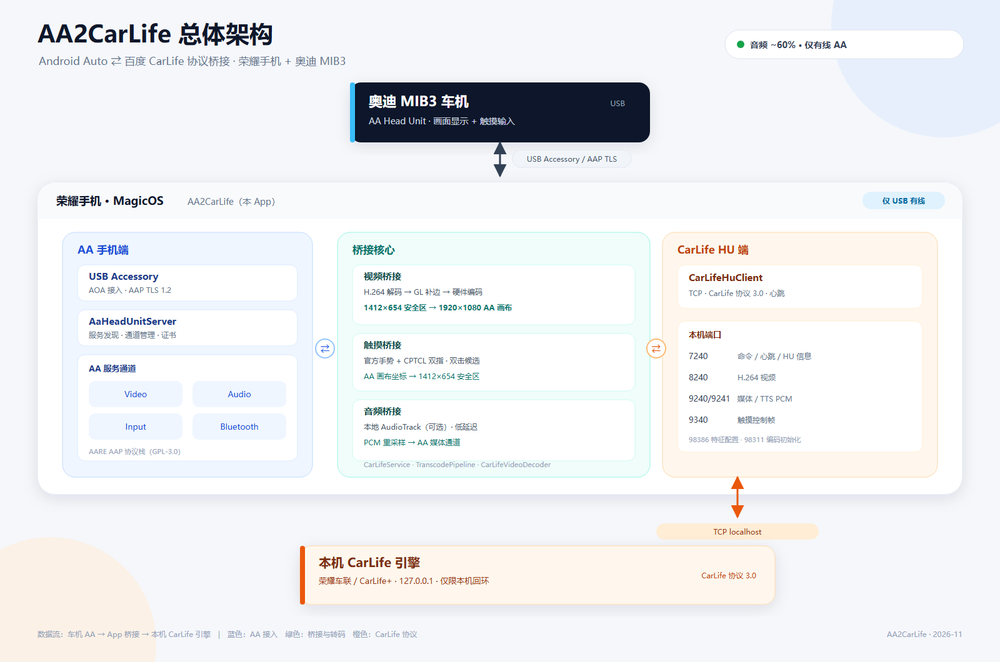

# AA2CarLife

把 **Android Auto（AA）手机端** 接到 **百度 CarLife 车机协议** 上的实验性桥接项目。

> 个人研究项目，开发中；视频流已打通，音频仍在完善。请勿用于商业用途，请勿在驾驶中操作。

## 免责声明（先读）

- 本项目与 Google、百度、荣耀、奥迪等公司没有任何关联，未获授权或背书。
- 仓库包含从 Android Auto 客户端提取的公开 AA 身份材料（见证书章节）；不包含本项目作者的个人私钥。
- 提取/使用 AA 证书可能违反 Google 服务条款；使用本项目的风险由使用者自行承担。
- 仅供个人学习、逆向工程研究；请遵守当地法律与设备/车辆保修条款。

## 它做什么

手机通过 USB accessory 模式被车机识别为一台 Android Auto 手机，与车机建立 AAP 会话
（TLS、服务发现、视频/音频/输入/蓝牙通道）；同时作为 CarLife HU 客户端连接本机的
CarLife 引擎（荣耀车联等），在两条协议之间转接画面、声音和触摸。

## 为什么做 AA2CarLife

目前已有不少 CarPlay → CarLife 的实现，但 CarPlay 对触摸事件的限制使其无法传递多指触控，
地图双指缩放、双指手势等操作做不了。

Android Auto 的输入协议支持多指触摸，因此 AA2CarLife 选择 AA 作为输入源，
把多指事件映射到 CarLife 的复合/多指触摸消息，补上 CarPlay 方案做不到的双指操作。



> 矢量版：`docs/images/architecture.svg`。数据流为车机 AA → App 桥接 → 本机 CarLife 引擎。

## 功能概览

- **AA 手机端**：USB accessory 接入、AAP 会话、服务发现、视频/音频/输入通道、蓝牙身份通道、占位画面。
- **CarLife**：7240 端口 TCP、命令/视频/音频/触摸通道、心跳、安全区与编码参数（98386/98311）。
- **视频**：CarLife H.264 解码 → GL 纹理 → 居中补边到 AA 画布 → 硬件编码（H.264 Baseline）。
- **触摸**：官方手势通道（单击/拖动/双击候选）+ CPTCL 双指管线；双击后拖动会立即下发第二个 DOWN。
- **音频**：CarLife 媒体 PCM 本地低延迟播放（可选），并可转发给 AA；支持 TTS 本地播放。
- **显示记忆**：按车机视频配置签名保存分辨率/安全区，第二次连接命中；可手动清除。
- **调试**：环形日志（`files/aa2cl.log`）、AAP 协议日志、USB 状态日志；日志不自动跟随，右下角 ↓ 到底部。

## 构建

要求：

- Android Studio 或命令行 Gradle；JDK 17+
- Android SDK **37**（`compileSdk = 37`，`minSdk = 31`，`targetSdk = 37`）
- 设备：Android 12+ 手机；实车验证：**荣耀手机 + 奥迪 MIB3 车机**

```bash
# 1. 配置 SDK 路径（不要提交这个文件）
echo 'sdk.dir=/path/to/Android/Sdk' > local.properties

# 2. 构建
./gradlew :app:assembleDebug

# 3. 安装
adb install -r app/build/outputs/apk/debug/app-debug.apk
```

> 如果本机没有 API 37，请自行下调 `app/build.gradle.kts` 里的 compileSdk/targetSdk。

## 证书（AA 身份材料）

AA 手机端需要一对 Google AA 身份文件：

```text
app/src/main/assets/aap/phone_chain.pem   # 证书链（O=CarService）
app/src/main/assets/aap/phone_key.pem     # 对应私钥
```

- 仓库内是 AA 客户端提取的公开材料，不是作者个人证书；
- 叶证书有效期至 **2027-02-17**，到期后需从新的 AA 版本更新；
- 仍受 Google 服务条款约束；来源与提取方法见 [docs/PROJECT.md](docs/PROJECT.md)。

## 使用

1. 打开 App，在高级选项里填写本机蓝牙地址（部分系统会脱敏 BT MAC，需要手填）。
2. 把荣耀车联切到 **CarLife → 无线连接 → 正在连接**（或按你的车机流程进入 CarLife 等待态）。
3. 手机插车机 USB；App 会自动启动 CarLife 会话并等待车机接入。
4. 需要本地预览/触摸时，勾选「显示画面预览」；需要本机劫持声音时，勾选「播放劫持声音」。
5. 默认两个开关都关闭，以节省本地解码/音频功耗；关闭预览时本地点按/滑动不可用。

## 触摸与音频说明

- 单指：官方手势通道；双指：自动回退 CPTCL（`0x6800B/0x68004/0x6800C/0x6800D`）。
- 双击拖动：第二下按下若在 350ms 窗口内，会立即下发 DOWN，避免目标 App 的双击窗口过期。
- 官方新模式（`0x68001`）在引擎复合通道里存在插值+延迟，当前不作为主路径。
- 本地 AudioTrack 目标缓冲约 20ms，但设备 `getMinBufferSize()` 可能把实际下限抬到约 85ms。

## 已知限制

- 视频流：已打通。
- 音频：进度约 60%。
- 目前只支持有线 AA（USB accessory）；无线 AA 尚未支持。
- 仅在作者自己的设备上测试过（荣耀手机 + 奥迪 MIB3 车机）。

## 目录结构

```text
app/     Android 应用（UI、CarLifeService、AA 桥接、转码管线）
aap/     vendored AARE AAP 协议栈 + 生成的 protobuf 类（GPL-3.0）
docs/    设计、协议、评审、台架验证文档
tools/   辅助脚本（SPP 解析、AOAP 探测、架构图生成）
```

## 日志与排错

```bash
adb shell run-as com.hobby.aa2carlife cat files/aa2cl.log
```

日志关键字：`AAP:`（协议）、`AA:`（桥接）、`CARLIFE:`（引擎会话）、`TRANSCODE:`（转码）、
`TESTPAT:`（测试图）、`USB:`（接入状态）。

## 许可

本项目整体以 **GPL-3.0** 发布（因为 `aap/` 来自 AARE）。详见 [LICENSE](LICENSE) 与 [NOTICE.md](NOTICE.md)。

- **AARE**（GPL-3.0-or-later）：`aap/` 协议栈与生成的 protobuf 类。
- **CarPToCarL**（MIT，Copyright (c) 2026 lizhihua）：CarLife 协议常量、部分实现与调试结论参考。

## 文档

完整项目说明见 [docs/PROJECT.md](docs/PROJECT.md)。

代码审计与清理建议见 [docs/CODE_AUDIT.md](docs/CODE_AUDIT.md)。