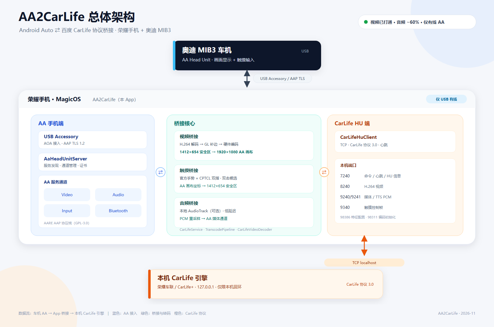

# AA2CarLife 项目文档

> 当前版本：2026-11-26。本文是当前实现的权威说明；旧文档已从当前树移除，历史版本仍可在 Git 记录中找回。

## 1. 项目定位

AA2CarLife 是一个实验性的 Android Auto（AA）到百度 CarLife 协议桥接。
车机以 AA head unit 身份接入手机；手机同时作为 CarLife HU 客户端连接本机 CarLife 引擎
（荣耀车联等），在两条协议之间转接视频、音频、触摸和部分控制信息。

当前用于个人设备上的互操作研究，不是可日常驾驶使用的产品。

### 为什么做 AA2CarLife

目前已有不少 CarPlay → CarLife 的实现，但 CarPlay 对触摸事件的限制使其无法传递多指触控，
地图双指缩放、双指手势等操作做不了。

Android Auto 的输入协议支持多指触摸，因此 AA2CarLife 选择 AA 作为输入源，
把多指事件映射到 CarLife 的复合/多指触摸消息，补上 CarPlay 方案做不到的双指操作。

## 2. 总体架构



矢量版：`images/architecture.svg`。数据流：车机 AA → App 桥接 → 本机 CarLife 引擎。

核心：AA 侧像一台车机，CarLife 侧像一台 CarLife HU；中间的视频转码和触摸映射由 App 完成。

## 3. 代码结构

```text
app/
  src/main/java/com/hobby/aa2carlife/
    MainActivity.kt        UI、日志、触摸分发、显示档案清理
    CarLifeService.kt      前台服务、会话生命周期、视频/音频转发
    aa/                    AA 侧：USB accessory、AAP、HeadUnit 服务
    carlife/               CarLife 协议、HU 客户端、解码、转码、音频
    ui/                    预览布局
    diag/                  环形日志
aap/                      vendored AARE AAP 协议栈 + protobuf 类（GPL-3.0）
docs/                     本文件
tools/                    辅助脚本
```

## 4. AA 手机端

### 4.1 USB accessory 与 AAP

手机以 USB accessory 模式被车机识别；App 通过 UsbAccessoryTransport 读写 accessory 端点。
AAP 使用 TLS，手机证书链/私钥放在：

```text
app/src/main/assets/aap/phone_chain.pem
app/src/main/assets/aap/phone_key.pem
```

仓库包含从 Android Auto 客户端提取的公开 AA 身份材料，方便复现；它们不是本项目作者的个人证书，但仍受 Google 服务条款约束。
如不想使用仓库内材料，可替换成自己合法获得的证书。没有证书时 App 能编译，但 AA 会话无法建立。

当前文件实测有效期：

| 证书 | Subject | 有效期（UTC） |
|---|---|---|
| CarService 叶证书 | `O=CarService` | 2014-07-04 → **2027-02-17 19:01:30** |
| Google Automotive Link 根证书 | `O=Google Automotive Link` | 2014-06-06 → 2044-06-05 18:28:19 |

提取工具：AARE 的 `extract_key.py`（https://github.com/prototux/AARE#aa-key-extraction）。
它从 Android Auto APK/APKM 中离线提取 `carservice_cert.pem`、`carservice_key.pem`、`gal_ca.pem`；
AARE 也可从 [iscle/android-auto-certificates](https://github.com/iscle/android-auto-certificates)
下载最新提取结果。叶证书到期后车机可能返回 `CERT_EXPIRED` / status -24，需要更新。
目前只支持有线 AA（USB accessory）；无线 AA 尚未支持。

### 4.2 服务发现

车机连接后发送 ServiceDiscoveryResponse，App 按服务类型打开通道：

- MediaSinkService 带 videoConfigs → 视频通道；
- MediaSinkService 的 audioType → 音频通道（MEDIA / GUIDANCE / SYSTEM / TELEPHONY）；
- InputSourceService → 触摸/按键通道；
- BluetoothService → 蓝牙身份通道；
- 传感器、手机状态、导航状态、通知等 → 对应状态/被动通道。

音频通道的 audioType 决定车机音量旋钮显示媒体还是导航；App 会把每个服务的
videoConfigs / audioType / input / sensor / bt 写进日志，便于排查。

### 4.3 视频画布

车机提供多个视频配置，App 按当前 CarLife 码流、已记忆配置、车机 preferred、
1080p/720p/480p 的顺序选择。CarLife 画面通常为 1412×654 安全区；AA 画布常见为 1920×1080。
转码不是简单拉伸：把 1412×654 居中画进 1920×1080，周围补边，避免车机端再次 letterbox。

## 5. CarLife HU 端

### 5.1 端口

| 端口 | 用途 |
|---|---|
| 7240 | 命令/控制、心跳、版本/设备信息 |
| 8240 | H.264 视频 |
| 9240 | 媒体 PCM |
| 9241 | TTS/导航 PCM |
| 9242 | VR |
| 9340 | 触摸（控制帧 8 字节头） |
| 9440 | 数据通道 |

### 5.2 握手与关键命令

- 使用 CarLife 协议 3.0；98386 特征配置里 CONTENT_ENCRYPTION=0，否则引擎可能进入加密路径。
- 98311 视频编码初始化：请求安全区尺寸/码率/GOP 等。
- 98386 还会声明 DISABLE_RESOLUTION_OPTION=1，让引擎按 HU 请求的分辨率编码。
- 引擎可能先发 65544（视频配置）；首帧必须是带 SPS/PPS 的关键帧，否则黑屏。

### 5.3 触摸消息

| 消息 | 含义 |
|---|---|
| 0x6800A | ACTION_BEGIN（按下开始手势） |
| 0x68002 | DOWN |
| 0x68004 | MOVE |
| 0x68003 | UP |
| 0x68005 | SINGLE_CLICK |
| 0x68006 | DOUBLE_CLICK |
| 0x68007 | LONG_PRESS |
| 0x68001 | 复合触摸动作（action + x/y） |
| 0x6800B | 第二根手指按下 |
| 0x6800C | 第一根手指抬起 |
| 0x6800D | 第二根手指抬起 |

## 6. 视频链路

```text
CarLife 8240 H.264
  → CarLifeHuClient 拆 12 字节头
  → TranscodePipeline: MediaCodec 解码 → GL 纹理 → 画进 1920×1080 画布
  → MediaCodec 编码（H.264 Baseline）
  → AA VideoChannel
```

本地预览是另一条可选路径：

```text
CarLife 8240 H.264 → CarLifeVideoDecoder → TextureView
```

关闭「显示画面预览」时，不创建本地预览解码器/Surface，只保留 AA 转码链路。
时间戳目前使用本地时钟，尚未把 CarLife PTS 原样传给 AA；这是后续改善音画同步的方向之一。

## 7. 触摸链路

### 7.1 单指：官方手势模式

- 按下：发 BEGIN；
- 第一次移动超过阈值：补 DOWN（用按下点），再发 MOVE；
- 后续 MOVE 节流发送；
- 抬手：拖动发 UP，点按发 SINGLE_CLICK / DOUBLE_CLICK。

双击判定窗口当前为 350ms，位置容差 60（目标域）。第二下按下时若命中双击候选，
会立即下发 DOWN，不再等移动超过 20px；这样避免目标 App 的约 300ms 双击窗口在等待中过期。

### 7.2 双指：CPTCL 管线

- 第二根手指出现时，从官方手势自动切到 CPTCL；
- 使用 0x6800B（第二指按下）、0x68004（双指 MOVE）、0x6800C/0x6800D（分指抬起）。

### 7.3 关于官方新模式

官方 SDK 的新模式在发送端是原始 MotionEvent 直通；但反汇编手机引擎可见
CarlifeTouchManager 对 0x68001 复合路径做了：

- 取上一点与当前点的中点先注入；
- 真正当前点延迟 (now - lastMoveTime)/2 调度；
- 还有 move event is too much, ignore 限频。

因此该路径在目标 App 上表现为滞后/松手才动，当前不作为主路径；主路径是官方手势 + CPTCL 双指。

### 7.4 坐标

AA 侧触摸是 1920×1080 画布坐标；CarLife 侧按安全区（如 1412×654）映射。
预览框与 AA 画布比例不同，触摸前会按当前视图尺寸和 carSafeArea 换算。

## 8. 音频链路

CarLife 音频分两条：

```text
媒体 9240 → CarLifeAudio（本地可选）
         └→ 重采样 44.1/48k → AA 媒体通道（车机）

TTS 9241 → CarLifeAudio（本地可选，当前不转发 AA）
```

### 8.1 本地播放

- 媒体和 TTS 各一条 AudioTrack；
- 关闭「播放劫持声音」时释放本地 AudioTrack，不影响转发 AA；
- 目标缓冲约 20ms，但设备 getMinBufferSize() 可能把实际下限抬到约 85ms
  （荣耀实测 15080 字节 @44.1k 立体声）；
- 低延迟模式创建失败会自动回退普通 AudioTrack；
- 创建后先等第一包 PCM 写入再 play()，减少启动爆音。

### 8.2 音量类型问题

车机音量旋钮显示导航还是媒体，取决于车机服务发现里音频通道的 audioType，
以及当前活跃的音频焦点。部分车机只暴露 guidance 通道，或目标 App 把音乐挂在导航流上；
这不是 App UI 能直接改的。

## 9. 显示分辨率记忆

- 首次连接：车机 preferred → 1080p → 720p → 480p 回落；
- 按车机视频配置列表 + margin + dpi 生成签名 key，保存该车的宽高/安全区/dpi；
- 第二次连接命中相同 key 时直接复用；
- 同一台车的配置签名稳定；两台车若配置完全相同，会共用一份档案；
- 高级选项提供「清除分辨率记忆」；
- 服务启动时先用上次安全区开 98311，AA 连上后再按本次车机配置校准。

## 10. UI 与默认值

当前界面（CarPToCarL 风格，滚动页）：

```text
AA2CarLife              ← 左上角软件名
未启动                  ← 状态
[ 连接 CARLIFE ]
高级选项（常显）
  显示：显示画面预览 / 播放劫持声音 / 测试图
  车机：清除分辨率记忆 / 本机蓝牙地址
  日志：日志 + ↓ 到底部
```

- 三个开关每次启动默认关闭；预览关闭时本地点按/滑动不可用；
- 日志不自动跟随；点右下角 ↓ 到最底部；
- 日志内部滚动优先，到顶/底后才把滚动交还整页；
- 预览内滑动会请求父级不要拦截，避免整页跟着滚。

## 11. 构建与运行

要求：

- Android Studio 或命令行 Gradle，JDK 17+；
- Android SDK 37，minSdk=31，targetSdk=37；
- 实车测试设备：**荣耀手机 + 奥迪 MIB3 车机**；主要验证系统：荣耀 MagicOS。

```bash
echo 'sdk.dir=/path/to/Android/Sdk' > local.properties
./gradlew :app:assembleDebug
adb install -r app/build/outputs/apk/debug/app-debug.apk
```

## 12. 日志与排错

```bash
adb shell run-as com.hobby.aa2carlife cat files/aa2cl.log
```

关键字：AAP:、AA:、CARLIFE:、TRANSCODE:、TESTPAT:、USB:、AUDIO:、TOUCH:。

| 现象 | 处理 |
|---|---|
| 7240 连接失败 | 荣耀车联要停在「正在连接」，不要退出到桌面 |
| 15s 内未收到版本匹配 | 引擎被旧协议污染；am force-stop com.baidu.carlife.honor 后重试 |
| 收到 65642 加密握手 | 确认 98386 的 CONTENT_ENCRYPTION=0，重启引擎 |
| 有 65544 但黑屏 | 没有首帧/IDR；看日志关键帧，重启引擎重试 |
| 触摸不同步 | 先看 TOUCH:/TOUCHMAP:；单指官方手势、双指 CPTCL |
| 车机音量只显示导航 | 看 AA: 服务[...] media(... audio=...)，确认车机是否提供 MEDIA 通道 |

## 13. 已知限制

- 视频流：已打通。
- 音频：进度约 60%。
- 目前只支持有线 AA（USB accessory）；无线 AA 尚未支持。
- 仅在作者自己的设备上测试过（荣耀手机 + 奥迪 MIB3 车机）。

## 14. 许可与来源

本项目整体以 GPL-3.0 发布，详见根目录 LICENSE 与 NOTICE.md。

- AARE（GPL-3.0-or-later）：aap/ 协议栈与 protobuf 类。
- CarPToCarL（MIT，Copyright (c) 2026 lizhihua）：CarLife 协议常量、部分实现与调试结论参考。

本项目与 Google、百度、荣耀、奥迪无关联，未获授权或背书。